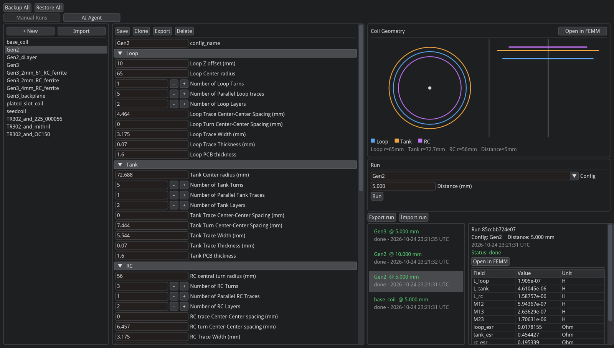
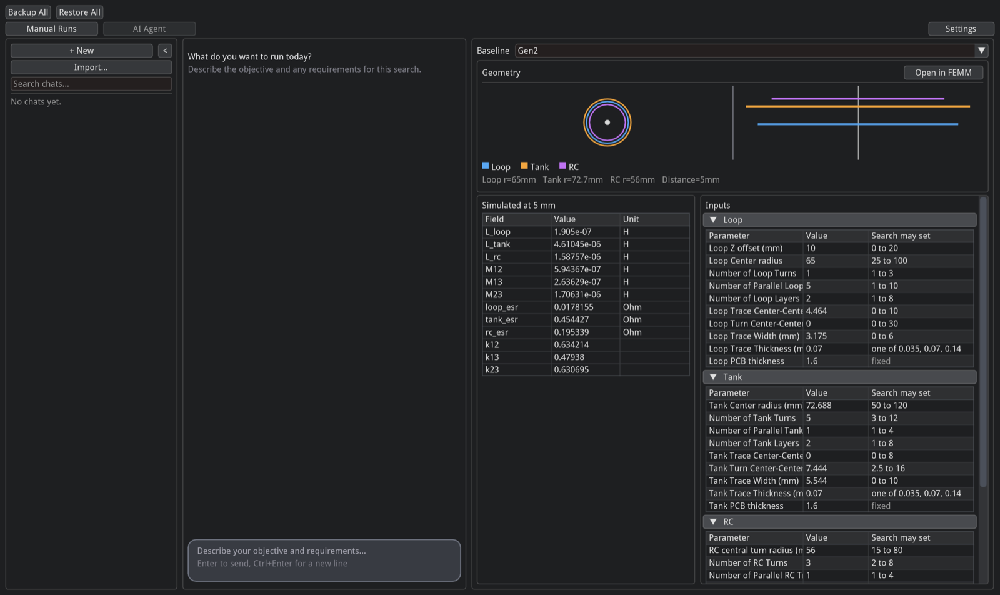
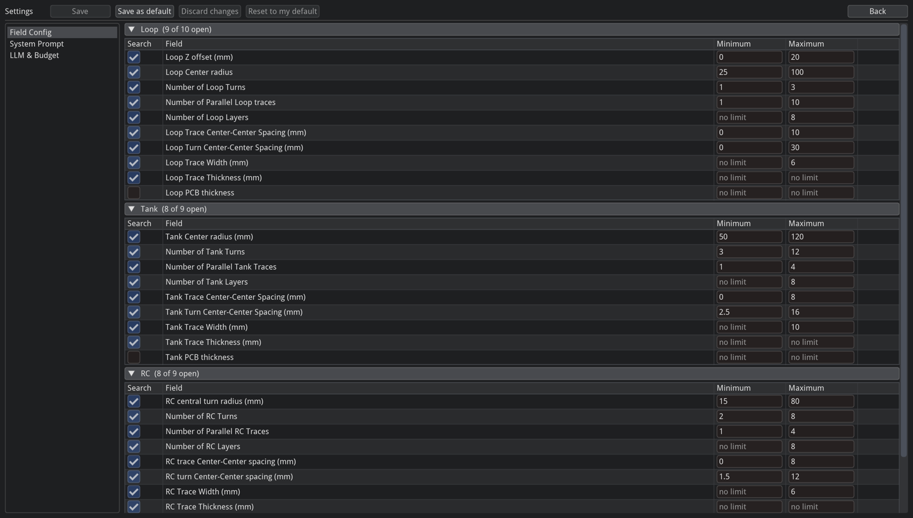

# FEMM Coil Automation

**A desktop app that designs wireless-power coils by simulation and has an AI agent improve them.**
You describe a goal in plain English. The agent runs real finite-element simulations and gives back a better coil.

> *"Keep the mutual inductance within 5% and cut the tank resistance by at least 20%."*
>
> The agent turns that sentence into a checkable plan and proposes geometry changes in batches. Each one is
> solved in parallel with a finite-element solver, scored in plain code, and the best design is shown next to
> the original.



## Why it exists

Wireless-power links at **6.78 MHz** use three flat spiral coils: a **Loop** (drive), a **Tank** (resonant
transmitter) and an **RC** (receiver). How well a design works depends on about 55 geometry parameters, such as
radii, turns, trace widths, layers, ferrite and shields. Trying a variant used to mean drawing it by hand in FEMM, a
Windows-only electromagnetics package, solving it, and copying the numbers out. This tool cuts that to one click,
and to zero clicks when the agent runs the search.

For any design and separation distance it reports twelve numbers: the inductance of each coil, the mutual
inductance of each pair, each coil's resistance (ESR), and the coupling `k`.

## Highlights

- **Physics engine with a solver fix.** It runs [xfemm](https://github.com/crobarcro/xfemm), an open-source port
  of FEMM, natively on Linux with no Wine or Windows. The bundled solver carries a one-line patch for an xfemm bug
  that rotated every mutual inductance by exactly 90°. After the fix, all twelve outputs match real FEMM 4.2 to
  about 1e-8 %.
- **An LLM agent that code keeps in check.** The model only *proposes* designs. Plain code decides whether a design
  is valid, which fields it may change, how it scores and when the search stops, so the model can't argue its
  way past any of those.
- **Parallel, cached simulation.** Every candidate is solved at every distance at the same time on a thread pool.
  Results are cached by a fingerprint of the geometry, so the same design is never solved twice.
- **Works offline with any model.** It works with any OpenAI-compatible `/v1/chat/completions` server, such as a
  local `llama-server`. That server is the app's only network call.
- **Human in the loop.** The user approves the plan before a search starts, owns the min/max limits for each field,
  and can stop, question, revise or continue a search from the same chat.
- **Built to be used daily.** Chats survive restarts, a search can be exported to JSON or a PDF report, and Backup All
  / Restore All moves everything to another machine. The tests run in about 10 seconds without an LLM server.

## Screenshots

**AI Agent.** Pick a baseline, then describe the goal in the chat. The right-hand column shows the baseline's
geometry, its simulated results, and the range the search is allowed to set for each field.



**Settings > Field Config.** Engineers choose which parameters the AI may change and set the limits for each one.
Any proposal outside these limits is rejected before it is simulated.



## Architecture

```
frontend/          Dear ImGui desktop app        renders state, never re-implements logic
   │  calls two agent runners + settings
backend/agent/     LLM interview + search loop   sentence → objective → batches of candidates → best design
   │  imports
backend/engine/    physics                       CoilSet in → Lua script → xfemm → SimResult (12 numbers) out
   │
SQLite (one local file)    xfemm (bundled, patched)    any OpenAI-compatible LLM server
```

**One request, start to finish**

1. **Interview.** The LLM asks one short question at a time, then calls a `finalize_spec` tool. Code validates the
   result into a spec of objectives (`match`, `reduce` or `increase` on any quantity), distances and fixed
   fields. A bad spec goes back to the user as a question.
2. **Approve.** The plan is shown as a table next to the baseline's own numbers. Nothing runs until the user clicks
   **Start Search**.
3. **Search loop.** In each round the model makes up to five `propose_coilset` calls. Code rejects invalid ones,
   each with a reason, and the engine solves the rest in parallel at every distance. A scorer ranks them.
4. **Stop.** Only code ends a search: a user request, the budget (rounds, wall clock, simulations), a plateau, or
   no progress. The chat then gets a plain-language summary that code writes from the best design's numbers.

### Key design decisions

| Decision | Why |
|---|---|
| **The model proposes, plain code decides.** Validity, allowed fields, scoring and stop rules are ordinary Python, not prompt text. | LLM output is non-deterministic. Keeping the rules that matter in code makes them testable, and the model can't ignore them. |
| **Batches of up to five candidates per LLM reply.** | One LLM reply takes minutes and one solve takes seconds. Asking for several designs per reply is where the time is saved. |
| **The worst distance decides, and margins are normalised by tolerance.** | A coil has to work across its whole range of distances. Normalising lets different quantities (H, Ω, k) be compared and ranked with one `rank_key()`. |
| **The prompt is rebuilt each round, not appended to.** It holds the best 10 designs, a one-line miss for each other attempt, and a code-written "lever notebook" of what each small step did. | Appending raw history once produced a 129 KB prompt by round 5, and it timed out. Rebuilding keeps the prompt small and the useful information in it. |
| **The search continues after the first pass** and stops only when nothing better appears for two rounds. | It narrows the run-to-run spread that comes from sampling, and reports the best design rather than the first one that passed. |
| **Bundled xfemm instead of FEMM under Wine.** | Each solve is an independent native process, so many run at once. Real FEMM is kept only for the optional **Open in FEMM** button, which lets a person inspect the mesh. |
| **2D axisymmetric model, one Lua script per solve.** Each coil is driven in turn and the flux linked into the others is read. | It turns a 3D problem into a fast 2D one, and one script gives both self- and mutual inductance. |
| **Streamed HTTP to the LLM.** | A hard wall-clock limit can only be enforced by closing the connection, and live reasoning text shows whether a slow round is still working or hung. |
| **One-way dependencies: frontend → agent → engine.** | The engine knows nothing above it, so it can be tested and reused on its own, for example by the `pi` terminal agent. |
| **One process, one window, one SQLite file.** Background work runs on threads that the UI polls every frame. | No second service to deploy, and the UI never blocks. |
| **A quantity the goal doesn't name is free to change.** | No hidden requirements. The inputs are guarded by the user's Field Config limits, and the outputs are checked wherever the goal names them. |

The full design notes, including the solver patch, scoring, memory and known limits, are in [`DESIGN.md`](DESIGN.md).

## Tech stack

Python 3.13 · Dear ImGui (`imgui-bundle`) · xfemm / FEMM 4.2 (finite-element magnetics) · Lua (generated solver
scripts) · SQLite · OpenAI-compatible LLM API with tool calling · `uv` workspaces · pytest

## Quick start

It runs on a Linux desktop (Debian or Ubuntu).

```bash
git clone https://github.com/grgevansdwy/femm-automation.git femm_automation
curl -LsSf https://astral.sh/uv/install.sh | sh     # installs Python and every dependency on first run
# open a new terminal so it finds uv, then:
cd femm_automation
uv run femm
```

A window called **FEMM Coil Automation** opens with 13 example designs. The first launch takes a few minutes to
download dependencies, and later launches take seconds.

**Optional: Open in FEMM.** This button draws the design in the real FEMM program so you can inspect the mesh. It
needs Wine and FEMM 4.2: run `sudo apt install -y wine`, download the installer from <https://www.femm.info> and run it
with `wine <installer>.exe`. If you install FEMM somewhere other than `C:\femm42`, set `FEMM_EXE` to the path of
`femm.exe`.

## Using it

**Manual Runs (no AI)**: click a design such as **Gen2**, enter a distance in mm, click **Run**, and read L, M, ESR
and k in **Run History**. **Clone** a design before editing it, then **Save**. **Export** and **Import** share one
design as a small file.

**AI Agent**

1. Pick a baseline and describe the goal, for example *"Keep the mutual inductance within 5% and cut the tank
   resistance by at least 20%."*
2. Answer its few questions, check the plan table, and click **Start Search**.
3. Anything you don't mention is **free to change**. If something matters, name it (*"keep every inductance within
   10%"*).
4. Stop early or change the goal from the same chat. Type `continue` to search further.
5. Right-click a chat to **Export JSON...** or **Export PDF report...**.

**LLM server**: open **Settings > LLM & Budget** and set **LLM server URL** and **Model name**. Any server that
speaks `/v1/chat/completions` with tool calling works.

**From a terminal**: the [`pi`](https://www.npmjs.com/package/@earendil-works/pi-coding-agent) coding agent can run
the same simulations on the same designs (`.pi/` holds its extension and skill). With Node.js 22.19 or newer, run
`npm install -g @earendil-works/pi-coding-agent`, then `pi --approve` in the project folder, and ask
*"Simulate Gen2 at 5 mm."*

## Development

```bash
uv run --package frontend --group test pytest backend   # about 10 s, no LLM server needed
cd backend && uv run python -m agent                    # run a search headless
python -m agent.benchmark                               # fixed goals against a real model, to measure prompt/loop changes
```

Every test gets its own empty database, and a script stands in for the LLM. The benchmark is what shows whether a
prompt or loop change actually makes the search better.

<details>
<summary><b>Troubleshooting</b></summary>

| What you see | What to do |
|---|---|
| `uv: command not found` | Close the terminal and open a new one |
| The window doesn't open, or a message mentions `libGL` or `libX11` | `sudo apt install -y libgl1 libx11-6 libxrandr2 libxinerama1 libxcursor1 libxi6` |
| Black or empty window on a remote or virtual machine | The app needs a desktop with OpenGL. A bare SSH session won't work |
| The AI can't connect | Check the network or VPN, then **Settings > LLM & Budget > LLM server URL** |
| The AI seems stuck after the computer woke from sleep | A request in flight during the sleep can be lost. It times out by itself (up to 15 minutes) and the search retries it |
| A run says "failed" | Click it in Run History to see the reason |
| **Open in FEMM** says Wine or FEMM is missing | Install them (see Quick start), or set `FEMM_EXE` |

</details>
